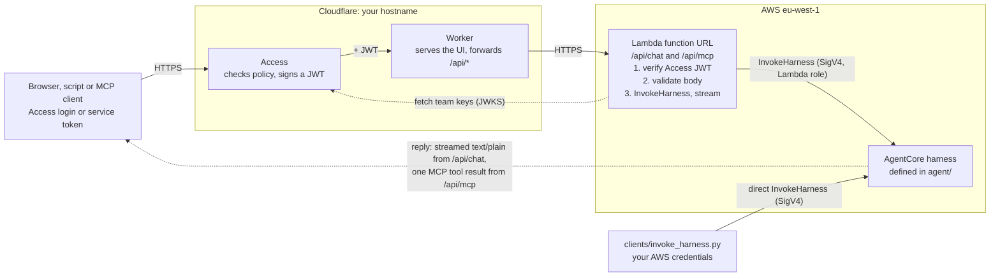

# AgentCore agent with a Cloudflare Access proxy

An agent on Amazon Bedrock AgentCore (a harness: a managed agent loop configured
in code), reachable from a browser chat UI, from scripts and from MCP clients
such as Claude Code, without handing out AWS keys. Cloudflare Access checks who you are; a Lambda verifies that and calls
the harness with its own IAM role.

## Repository layout

Each folder is one thing you change or deploy, with its own README:

| Folder | What it is | Deployed with |
|---|---|---|
| [`agent/`](agent/README.md) | What the agent is: model, tools, MCP servers, limits, system prompt. Edit this most often. | `cdk deploy` in `aws/` |
| [`aws/`](aws/README.md) | CDK app: the harness, its execution role, and the Lambda proxy. | `npx cdk deploy`, or GitHub Actions ([setup](docs/SETUP.md#automated-deploys-from-github-actions)) |
| [`cloudflare/`](cloudflare/README.md) | The Access setup, the edge Worker, and the chat UI it serves. | `npx wrangler deploy` |
| [`clients/`](clients/README.md) | Scripts that call the agent, directly or through the proxy. | — |
| [`docs/`](docs/) | Architecture diagram, setup decisions, troubleshooting. | — |

## Local settings

Values tied to your setup (hostname, Access settings, account id, tokens) live
only in git-ignored files, each copied from an `*.example` template. Each tool
reads its own file, so check this list before the step that needs it:

| File (git-ignored) | Copy from | Holds | Needed for |
|---|---|---|---|
| `aws/deploy.local.json` | `aws/deploy.local.example.json` | Access team domain and AUD tag; optionally `harnessArns`, `reservedConcurrency` | Step 2, `cdk deploy` |
| `cloudflare/worker/wrangler.jsonc` | `cloudflare/worker/wrangler.example.jsonc` | your hostname and the `FunctionUrl` from step 2 | Step 3, `wrangler deploy` |
| `.env` | `.env.example` | **secret:** Access service token; proxy URL and `HARNESS_ARN` | Step 4, the `clients/` scripts |
| GitHub repository variables | (not a file) | `AWS_DEPLOY_ROLE_ARN`, `AWS_DIFF_ROLE_ARN`, `ACCESS_TEAM_DOMAIN`, `ACCESS_AUD` | optional, [automated deploys](docs/SETUP.md#automated-deploys-from-github-actions) |

Only `.env` holds a secret. The team domain and AUD tag appear in both
`aws/deploy.local.json` and the GitHub variables, so keep them the same.

## Quick start

1. **Cloudflare Access:** create the Access application
   ([`cloudflare/`](cloudflare/README.md#1-access-application)).
2. **AWS:** sign in (`aws login`, see [AWS credentials](clients/README.md#aws-credentials)),
   then deploy both stacks ([`aws/`](aws/README.md#deploy)).
3. **Cloudflare Worker and UI:** build the UI and deploy the Worker
   ([`cloudflare/`](cloudflare/README.md#2-worker-and-web-ui)).
4. **Use it:** open `https://<your-hostname>/`, or run
   `uv run clients/invoke_proxy.py "Hello"` ([`clients/`](clients/README.md)).
   MCP clients such as Claude Code can call it at `https://<your-hostname>/api/mcp`
   ([MCP](aws/README.md#mcp)).

To change the agent afterwards, edit [`agent/agent.ts`](agent/agent.ts) or
[`agent/system-prompt.md`](agent/system-prompt.md) and run
`npx cdk deploy AgentHarness` in `aws/`.

## Architecture

A diagram of the proxy path and the direct call is in
[`docs/architecture.html`](docs/architecture.html); open it in a browser.
[`docs/SETUP.md`](docs/SETUP.md) explains how it was set up and why, and
[`docs/TROUBLESHOOTING.md`](docs/TROUBLESHOOTING.md) lists problems met along the
way, with fixes.

The direct path calls the `InvokeHarness` API at
`bedrock-agentcore.<region>.amazonaws.com`, signed with SigV4. The runtime behind
a harness can't be invoked directly: calling `InvokeAgentRuntime` on it returns
"managed by a harness and cannot be invoked directly".
