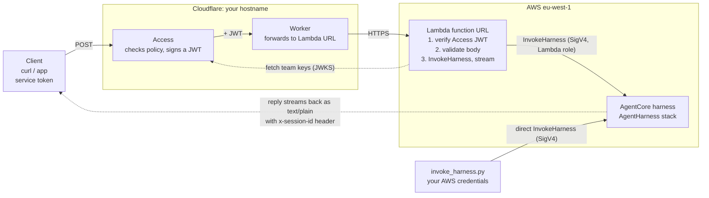

# AgentCore harness test

`invoke_harness.py` sends a message to an Amazon Bedrock AgentCore harness and
streams the reply to your terminal.

## Setup

You need:

- [uv](https://docs.astral.sh/uv/) (`brew install uv`)
- AWS credentials in `~/.aws/credentials` (the default profile) that are allowed
  to call `bedrock-agentcore:InvokeHarness` on the harness
- The harness ARN in a git-ignored `.env` file: copy `.env.example` to `.env`
  and set `HARNESS_ARN`

There is nothing to install by hand. The script declares its own dependencies
(`boto3>=1.42`, the first versions with the harness API), and `uv run` creates a
cached environment on first use.

Check that your credentials work:

```sh
aws sts get-caller-identity
```

## Usage

```sh
uv run invoke_harness.py "Hello, who are you?"
```

Options:

| Option | Description |
|---|---|
| `--harness-arn ARN` | Harness to call. Default: `HARNESS_ARN` from `.env`. The region is read from the ARN. |
| `--session-id ID` | Reuse a session id to continue a conversation. Must be at least 33 characters. Default: a new random id per run. |
| `--max-tokens N` | Maximum output tokens. Default: 1000. |

Examples:

```sh
# Pass a harness explicitly (the default is HARNESS_ARN)
uv run invoke_harness.py \
  --harness-arn arn:aws:bedrock-agentcore:<region>:<account-id>:harness/<harness-id> \
  "Hello"

# Continue a conversation
uv run invoke_harness.py --session-id my-test-session-0000000000000000001 "Remember the number 7"
uv run invoke_harness.py --session-id my-test-session-0000000000000000001 "What number did I say?"
```

The reply streams to stdout. The session id and token count are printed to
stderr, so you can pipe the reply without them.

## Using the proxy (no AWS credentials needed)

`invoke_proxy.py` calls the same harness through the Cloudflare Access proxy
described under [Architecture](#architecture). It needs a Cloudflare Access
service token instead of AWS credentials, and only uses the Python standard
library.

```sh
cp .env.example .env     # then fill in the three values
chmod 600 .env           # .env is git-ignored; never commit it
uv run invoke_proxy.py "Hello, who are you?"
uv run invoke_proxy.py --session-id my-test-session-0000000000000000001 "Remember 7"
```

| Setting | Meaning |
|---|---|
| `PROXY_URL` | The public hostname of the proxy. |
| `CF_ACCESS_CLIENT_ID` | The service token's Client ID (ends in `.access`). |
| `CF_ACCESS_CLIENT_SECRET` | The service token's secret. Shown only once; keep it in a password manager. |

Run it from the repository root. See [`docs/TROUBLESHOOTING.md`](docs/TROUBLESHOOTING.md)
if it returns an error.

### Finding the values for `.env`

`.env.example` has the same notes next to each setting.

| Setting | Where to find it |
|---|---|
| `HARNESS_ARN` | In the AWS console, open Amazon Bedrock AgentCore, find your harness and copy its ARN. It looks like `arn:aws:bedrock-agentcore:<region>:<account-id>:harness/<harness-id>`. Your account id is `aws sts get-caller-identity --query Account --output text`. Only `invoke_harness.py` uses it. |
| `PROXY_URL` | The public hostname you gave the Cloudflare Access application and the Worker's custom domain (the `routes` pattern in `infra/worker/wrangler.jsonc`), as `https://<hostname>/`. |
| `CF_ACCESS_CLIENT_ID` | Cloudflare Zero Trust, then Access controls, then Service credentials, then Service Tokens. Create a token and copy its **Client ID**. It ends in `.access`. |
| `CF_ACCESS_CLIENT_SECRET` | Shown only once, when you create the token. If you lost it, use **Refresh** on the token to get a new one, and update `.env`. |

The service token only works if a policy on the Access application has the action
**Service Auth** and includes that token. A token inside an **Allow** policy is
rejected. Treat the client secret like a password: keep it in a password manager,
keep `.env` at mode `600`, and never commit or paste it into chat. Create one
token per client so you can revoke one without breaking the others.

## The harness

The harness is defined in this repository and deployed as the `AgentHarness`
CDK stack (`infra/lib/agent-harness-stack.ts`). It runs in eu-west-1, has no
tools and no memory, and its runtime uses a `PUBLIC` network.

- **System prompt:** [`infra/harness/system-prompt.md`](infra/harness/system-prompt.md).
- **Model and name:** `modelId` and `harnessName` in the git-ignored
  `infra/deploy.local.json` (defaults: `eu.amazon.nova-micro-v1:0` and
  `agent_harness`).
- **ARN:** a stack output and an SSM parameter. It is not stored in the
  repository. Put it in your local `.env` as `HARNESS_ARN` for the scripts.

To change the prompt or the model, edit them and run `npx cdk deploy --all` from
`infra/`. See [`infra/README.md`](infra/README.md#the-harness-stack).

## Architecture

A diagram of the proxy path (client, Cloudflare Access, Lambda, harness) and the
direct call is in [`docs/architecture.html`](docs/architecture.html). Open it in
a browser. See also [`infra/README.md`](infra/README.md) for deploying the proxy
and [`docs/SETUP.md`](docs/SETUP.md) for how it was set up and why. Problems
met along the way, with fixes, are in [`docs/TROUBLESHOOTING.md`](docs/TROUBLESHOOTING.md).



## How it works

The script calls the `InvokeHarness` API at
`bedrock-agentcore.<region>.amazonaws.com`, signed with SigV4 using your AWS
credentials. Calls without valid credentials are rejected.

The runtime behind a harness can't be invoked directly. Calling
`InvokeAgentRuntime` on it returns "managed by a harness and cannot be invoked
directly".

## Troubleshooting

For the proxy (`invoke_proxy.py`, Cloudflare, the Worker and the Lambda) see
[`docs/TROUBLESHOOTING.md`](docs/TROUBLESHOOTING.md). For direct calls with
`invoke_harness.py`:

- **`AccessDeniedException` mentioning AWS Marketplace:** the Claude model isn't
  enabled for the account yet. Enable it in the Bedrock console (model catalog),
  wait about 5 minutes and retry.
- **`AccessDeniedException` on `InvokeHarness`:** your credentials lack
  `bedrock-agentcore:InvokeHarness` on the harness. If the message names
  `bedrock-agentcore:InvokeAgentRuntime` on the harness ARN, grant that action
  too.
- **`Unknown operation` or a missing method:** boto3 is too old. Run
  `uv cache clean boto3` and try again.
- **Session id error:** `--session-id` must be at least 33 characters.
